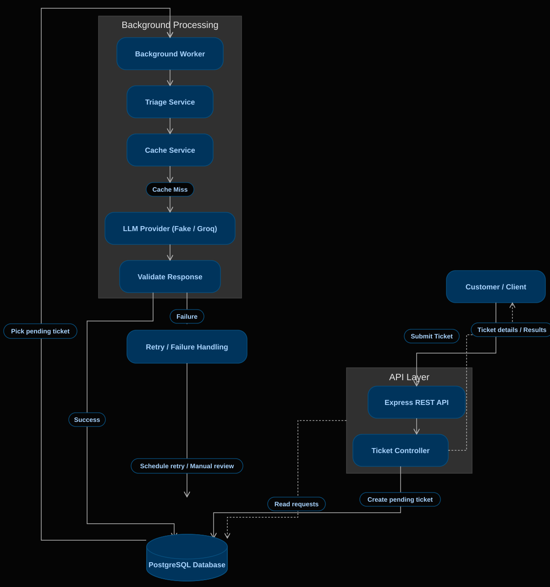

# AI Support Ticket Triage Service

The **AI Support Ticket Triage Service** is a backend application that automatically handles customer support tickets. It accepts tickets from customers through a simple REST API and saves them directly to a PostgreSQL database. A background worker then picks up each ticket and uses an AI model (LLM) to determine its category, assign a priority, and generate a brief summary. The system is built to be reliable by handling retries when errors happen, recovering abandoned tickets, caching results to save costs, and safely supporting multiple workers at the same time.

## System Architecture



The Express API handles ticket submission and retrieval, while a separate background worker processes pending tickets. PostgreSQL acts as both the primary database and the job queue.

## Tech Stack

| Technology | Purpose |
| :--- | :--- |
| **Node.js** | Backend runtime |
| **Express.js** | REST API framework |
| **PostgreSQL (Neon)** | Database and queue storage |
| **Prisma** | ORM and migrations |
| **Groq** | Fast cloud LLM provider |
| **Fake Provider** | Local testing without paid API keys |
| **JavaScript** | Application language (CommonJS) |

## Project Structure

```text
Backend/
├── src/
│   ├── config/
│   ├── constants/
│   ├── controllers/
│   ├── prompts/
│   ├── providers/
│   ├── routes/
│   ├── services/
│   ├── utils/
│   ├── workers/
│   └── app.js
├── database/
│   ├── migrations/
│   ├── schema.prisma
│   └── schema.sql
├── .env.example
├── package.json
└── README.md
```

### Folder Explanations
- **`config/`**: Sets up the central Prisma client and database connection checks.
- **`constants/`**: Holds fixed arrays for ticket categories, priorities, and statuses.
- **`controllers/`**: Validates incoming request data and returns HTTP responses.
- **`prompts/`**: Formats structured instructions and rules sent to the LLM.
- **`providers/`**: Implements the AI providers (live Groq API and simulated Fake provider).
- **`routes/`**: Connects HTTP endpoints (e.g., `/api/tickets`) to their controllers.
- **`services/`**: Contains core triage execution and database caching operations.
- **`utils/`**: Utility helpers such as generating deterministic SHA-256 cache keys.
- **`workers/`**: Manages the continuous polling loop, row locking, and retry handling.
- **`database/`**: Manages database migrations, the Prisma schema, and SQL definitions.

## Database Design

The database uses PostgreSQL with three main tables:

### 1. `tickets`
Stores the original customer support ticket and tracks its progress through the queue:
- **`id`**: Unique UUID for each ticket.
- **`subject`**: Title of the customer issue (max 255 characters).
- **`body`**: Full description of the issue (unlimited text).
- **`customer_email`**: Contact email of the customer.
- **`status`**: Current state (`pending`, `processing`, `retry_wait`, `completed`, `needs_review`).
- **`retry_count`**: Number of retries attempted (up to 3).
- **`next_retry_at`**: Timestamp when the next retry attempt is allowed.
- **`locked_at`**: Timestamp when a worker claimed the ticket (used to detect abandoned tickets).
- **`created_at` / `updated_at`**: Automatic timestamps.

### 2. `triage_results`
Stores the final, validated AI classification for a ticket (one-to-one relationship with `tickets`):
- **`id`**: Unique UUID for the result.
- **`ticket_id`**: Foreign key linking to the `tickets` table (with cascade delete).
- **`category`**: Assigned category (`billing`, `technical`, `account`, `feedback`, `other`).
- **`priority`**: Assigned urgency (`low`, `medium`, `high`, `urgent`).
- **`summary`**: A concise, one-sentence summary generated by the AI.
- **`created_at`**: Timestamp when the result was created.

### 3. `triage_cache`
Stores reusable triage results to avoid paying for or re-running the AI on identical tickets:
- **`id`**: Unique UUID for the cache record.
- **`cache_key`**: 64-character SHA-256 hash computed from normalized ticket text, model name, and prompt version.
- **`category`**, **`priority`**, **`summary`**: The reusable AI outputs.
- **`created_at`**: Timestamp when the cache entry was saved.

## Setup and Installation

### 1. Install Dependencies
Navigate to the `Backend` directory and install dependencies:
```bash
cd Backend
npm install
```

### 2. Configure Environment Variables
Create a `.env` file in the `Backend` directory:
```env
PORT=3000
DATABASE_URL="postgresql://<user>:<password>@<neon-host>/<dbname>?sslmode=require"

# Choose "fake" for free local simulation, or "groq" for live AI
LLM_PROVIDER=fake
GROQ_API_KEY=your_groq_api_key_here
GROQ_MODEL=openai/gpt-oss-120b
```

### 3. Run Database Migrations
Apply the migrations to your PostgreSQL database:
```bash
npx prisma migrate dev
```
Generate the Prisma Client:
```bash
npx prisma generate
```

### 4. Start the Application
Open two terminal windows in the `Backend` folder:

- **Terminal 1: Start the API Server**
  ```bash
  npm run dev
  # Server runs on http://localhost:3000
  ```

- **Terminal 2: Start the Background Worker**
  ```bash
  npm run worker
  # Worker starts polling and processing tickets
  ```

## API Documentation

| Method | Endpoint | Purpose |
| :--- | :--- | :--- |
| **POST** | `/api/tickets` | Submit a new customer support ticket |
| **GET** | `/api/tickets/:id` | Fetch a single ticket along with its triage result |
| **GET** | `/api/tickets` | List tickets with filters and pagination |

---

### 1. Submit a Ticket

- **Endpoint:** `POST /api/tickets`
- **Request Headers:** `Content-Type: application/json`
- **Request Body:**
  ```json
  {
    "subject": "Payment deducted twice",
    "body": "I was charged twice for order #1234 on my credit card.",
    "customerEmail": "customer@example.com"
  }
  ```
- **Validation Rules:**
  - `subject`: Required string, maximum 255 characters, cannot be empty or spaces.
  - `body`: Required string, cannot be empty or spaces.
  - `customerEmail`: Required string, valid email format, maximum 255 characters.
- **Successful Response (`201 Created`):**
  ```json
  {
    "id": "3b2f9f1e-4c7b-4e12-8e6d-5a8b7c9d0e1f",
    "status": "pending"
  }
  ```
- **Validation Failure (`400 Bad Request`):**
  ```json
  {
    "message": "Validation failed",
    "errors": [
      "Subject is required",
      "Please provide a valid email address"
    ]
  }
  ```
- **Server Error (`500 Internal Server Error`):**
  ```json
  {
    "message": "Failed to create ticket"
  }
  ```

---

### 2. Fetch One Ticket and Its Result

- **Endpoint:** `GET /api/tickets/:id`
- **URL Parameter:** `id` (Valid UUID of the ticket)
- **Successful Response (`200 OK`):**
  ```json
  {
    "id": "3b2f9f1e-4c7b-4e12-8e6d-5a8b7c9d0e1f",
    "subject": "Payment deducted twice",
    "body": "I was charged twice for order #1234 on my credit card.",
    "customerEmail": "customer@example.com",
    "status": "completed",
    "retryCount": 0,
    "createdAt": "2026-11-06T10:00:00.000Z",
    "updatedAt": "2026-11-06T10:00:02.000Z",
    "triageResult": {
      "category": "billing",
      "priority": "high",
      "summary": "Customer was charged twice for a single order.",
      "createdAt": "2026-11-06T10:00:02.000Z"
    }
  }
  ```
- **Invalid ID Format (`400 Bad Request`):**
  ```json
  {
    "message": "Invalid ticket ID format"
  }
  ```
- **Ticket Not Found (`404 Not Found`):**
  ```json
  {
    "message": "Ticket not found"
  }
  ```
- **Server Error (`500 Internal Server Error`):**
  ```json
  {
    "message": "Failed to fetch ticket"
  }
  ```

---

### 3. List Tickets with Filters and Pagination

- **Endpoint:** `GET /api/tickets`
- **Query Parameters (all optional):**
  - `status`: Filter by status (`pending`, `processing`, `retry_wait`, `completed`, `needs_review`).
  - `category`: Filter by category (`billing`, `technical`, `account`, `feedback`, `other`).
  - `priority`: Filter by priority (`low`, `medium`, `high`, `urgent`).
  - `page`: Page number (integer >= 1, default `1`).
  - `limit`: Items per page (integer between 1 and 100, default `10`).
- **Example Request:**
  ```
  GET /api/tickets?status=completed&category=billing&page=1&limit=10
  ```
- **Successful Response (`200 OK`):**
  ```json
  {
    "data": [
      {
        "id": "3b2f9f1e-4c7b-4e12-8e6d-5a8b7c9d0e1f",
        "subject": "Payment deducted twice",
        "body": "I was charged twice for order #1234 on my credit card.",
        "customerEmail": "customer@example.com",
        "status": "completed",
        "retryCount": 0,
        "createdAt": "2026-11-06T10:00:00.000Z",
        "updatedAt": "2026-11-06T10:00:02.000Z",
        "triageResult": {
          "category": "billing",
          "priority": "high",
          "summary": "Customer was charged twice for a single order.",
          "createdAt": "2026-11-06T10:00:02.000Z"
        }
      }
    ],
    "pagination": {
      "currentPage": 1,
      "limit": 10,
      "totalTickets": 1,
      "totalPages": 1
    }
  }
  ```
- **Invalid Filter or Page (`400 Bad Request`):**
  ```json
  {
    "message": "Invalid status filter"
  }
  ```
- **Server Error (`500 Internal Server Error`):**
  ```json
  {
    "message": "Failed to fetch tickets"
  }
  ```

---

## Background Processing Workflow

The background worker runs in a separate process and operates **completely independently from the REST API**:

- When a customer submits a ticket through `POST /api/tickets`, the API immediately saves the ticket with `status: 'pending'` and returns an HTTP 201 response. The customer receives an instant response and never waits for the AI model to finish.
- The background worker continuously monitors the database and processes tickets step by step:

1. **Checks for Abandoned Tickets:**  
   The worker first looks for any ticket that has been stuck in the `processing` state for longer than 5 minutes (for example, if a previous worker crashed or the server rebooted). It recovers these tickets, increments their retry count, and puts them back into the retry queue.

2. **Claims the Next Eligible Ticket:**  
   The worker queries PostgreSQL for the oldest ticket with `status = 'pending'` or `status = 'retry_wait'` whose scheduled retry time has arrived. It uses PostgreSQL's `FOR UPDATE SKIP LOCKED`, which locks the row so no other worker can take the same ticket.

3. **Marks the Ticket as Processing:**  
   The claimed ticket's status is changed to `processing` and `locked_at` is set to the current time, indicating that work is in progress.

4. **Passes the Ticket to the Triage Service:**  
   The worker gives the ticket to the triage service. The service first creates a unique SHA-256 hash of the ticket text, model, and prompt to check if this exact issue has already been triaged:
   - **Cache Hit:** Reuses the existing result immediately without calling the AI.
   - **Cache Miss:** Sends the ticket to the AI provider (Groq or fake provider) and strictly validates the returned category, priority, and summary.

5. **Saves the Validated Result:**  
   The triage service creates a permanent record in the `triage_results` table and stores the result in the `triage_cache` table for future tickets.

6. **Marks the Ticket as Completed:**  
   In the same atomic database transaction, the ticket's status is updated to `completed`, and its lock timestamp is cleared. If any error occurred during processing, the retry handler takes over to schedule a retry instead.

## LLM Integration and Prompt Design

### Why Groq and Model Used
I selected **Groq** over Gemini due to its ultra-fast inference speed, ensuring near-instant classification and summarization of support tickets. The application defaults to the `openai/gpt-oss-120b` model, which is configurable via the `GROQ_MODEL` environment variable without code changes.

### Prompt Design & Security
A specialized system prompt analyzes each ticket:
- Combines the ticket subject and body with allowed categories and priorities.
- Instructs the model to output a one-sentence summary in strict JSON format.
- Prompt Injection Defense: Explicitly instructs the model to treat customer input strictly as untrusted data, preventing ticket text from overriding classification rules.

### Allowed Classifications

- **Categories (selects exactly one):**
  - `billing`: Payments, refunds, invoices, or double charges.
  - `technical`: System bugs, crashes, or application errors.
  - `account`: Login issues, password resets, or account access.
  - `feedback`: Product suggestions and feature requests.
  - `other`: General questions not fitting standard categories.

- **Priorities (selects exactly one):**
  - `low`: Minor issues or general questions.
  - `medium`: Inconvenient issues with available workarounds.
  - `high`: Major issues significantly impacting the user.
  - `urgent`: Critical outages or blocking issues requiring immediate attention.

### Expected JSON Response
```json
{
  "category": "billing",
  "priority": "high",
  "summary": "Customer was charged twice for the same order."
}
```
*The response is strictly validated by the application before saving to the database.*

### Fake LLM Provider (Free Local Testing)
The project includes a built-in **Fake Provider** to run and test the complete system without any paid API key:
- Controlled by `LLM_PROVIDER=fake`

---

## Scalability and Trade-offs
The current application uses PostgreSQL as both the main database and the job queue. This is a simple approach that works well for the scope of this assignment. However, at higher traffic, a few limitations may appear.

**A**. **What Would Break First at 10,000 Tickets/Hour?**
- Each ticket is processed with the help of background worker.If the tickets arrives at the faster speed than workers can process the tickets will start accumulating.
- The LLM Provider may also have some rate limits on the number of requests we send.
- Workers continuously check PostgreSQL for pending tickets. With more workers and incoming tickets, frequent database polling and ticket updates can increase database load.


**B**. **How Would I Scale to 1 Million Tickets/Day?**

To handle a much larger number of tickets, I would gradually improve the current architecture:

1. **Introduce Redis for Background Job Management**  
   Currently, PostgreSQL is used to manage background jobs. At larger scale, I would consider using Redis (with BullMQ) to manage pending jobs separately from the main database. This would reduce frequent polling on PostgreSQL and help manage background processing more efficiently.

2. **Scale Background Workers Horizontally**  
   I would run multiple worker instances across different processes, containers, or servers. This would allow more tickets to be processed in parallel and increase overall throughput.

3. **Batch Processing Where Supported**  
   If the LLM provider supports batch requests, I would consider grouping tickets to reduce network overhead and improve processing efficiency.

4. **Rate Limiting**  
   I would control the number of requests sent to the LLM provider based on its rate limits. This would prevent overloading the provider and avoid building an unnecessarily large processing backlog.

